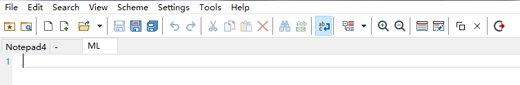

# Notepad4-ML (Notepad4-MultiLabel)

Notepad4-ML 是基于 [Notepad4](https://github.com/zufuliu/notepad4) 的多标签分支版本，
为这个原本单文档的轻量编辑器增加了标签页与滚动条匹配标记。

- **版本**：0.1
- **基于上游**：Notepad4 v26.10 (r6392, 7b269f54)
- **上游基线提交**：`3afea94b18c469b95b504553a5ece1a9e4c57d9e`（2026-10-23）
- **许可**：BSD 3-Clause，见 [LICENSE](LICENSE)（全文）与 [NOTICE](NOTICE)（上游版权与分支说明）

## 与上游的关系

Notepad4-ML **不是** Notepad4 官方版本，也不由 Notepad4 作者维护。
它是一个独立的分支：

- 上游项目：<https://github.com/zufuliu/notepad4>
- 上游版权归 Zufu Liu 及所有贡献者所有
- 本分支只在上游基础上增加了下列功能，其余行为与上游一致

## 本分支新增的功能

1. **多标签页**
   - 顶部标签栏，显示文件名与未保存标记 `*`
   - `Ctrl+Tab` / `Ctrl+Shift+Tab` 切换，`Ctrl+W` 关闭，`Ctrl+N` 新建
   - 每个标签独立保存内容、撤销历史、光标、滚动位置、编码、换行符、只读状态
   - File 菜单：Close Tab / Close All Tabs / Open in New Window
   - 工具栏：关闭当前标签、在新窗口中打开
2. **垂直滚动条上的匹配标记**
   - “标记全部匹配”或“查找全部”时，在真正的垂直滚动条上按行位置画出标记
   - 滚动时标记保持可见
   - Settings → Scroll Mark Settings 可设置颜色与不透明度，保存在 ini 中
3. **只从新窗口打开**
   - Settings 中的勾选项，勾选后新建与打开文件都在新窗口中打开
   - 立即生效并写入配置，重启后保持
4. **在新窗口中打开（移动语义）**
   - 把当前标签的文件移动到新窗口，原标签随即关闭
   - 未保存的内容也能一起带过去：通过临时文件中转，**不会**写回原文件，
     也不会弹出保存对话框
   - 新窗口中的副本显示为未命名文档，保存时会要求选择文件名

## ⚠️ 关于 AI 的声明

**本项目的代码改动主要由 AI（大型语言模型）生成，并经人工审阅与自动化测试验证。**

这意味着：

- 代码风格、实现方式可能与上游项目不一致
- 可能存在未被测试覆盖的边界问题
- 不建议在关键生产环境中替代上游 Notepad4 而不做额外验证
- 欢迎指出问题，但请理解维护者不是所有代码的原始作者

如果你需要最稳定、经过长期检验的版本，请使用上游 Notepad4。

## 反馈问题前请先区分责任

提交 issue 前，**请先确认上游 Notepad4 是否也存在同样的问题**：

1. 从 <https://github.com/zufuliu/notepad4/releases> 下载最新官方 Notepad4
2. 用同样的步骤复现一次
3. 按下表判断应该提交到哪里：

| 现象 | 提交位置 |
| --- | --- |
| 官方 Notepad4 也能复现（语法高亮、编码、打印、词法分析等） | 上游 <https://github.com/zufuliu/notepad4/issues> |
| 只在 Notepad4-ML 出现（标签、滚动条标记、新窗口相关） | 本项目 issue |
| 不确定 | 先在本项目 issue 中说明“官方版本是否复现” |

请在 issue 中写明：

- Notepad4-ML 版本（关于对话框中的 `0.1` 及基于的上游版本）
- Windows 版本
- 复现步骤
- 是否已在官方 Notepad4 上复现

## 下载与使用

Release 中提供 64 位构建：

| 文件 | 说明 |
| --- | --- |
| `Notepad4-ML.exe` | 主程序（多标签版本） |
| `matepath.exe` | 上游附带的文件浏览器插件 |
| `locale/<lang>/Notepad4-ML.dll` | 界面语言资源（可选，按需放） |
| `LICENSE` | 许可证 |

建议解压到同一目录使用。`locale` 目录可选，缺少时界面为英文。

支持的语言：英语、简体中文、繁体中文、日语、韩语、德语、法语、意大利语、
波兰语、葡萄牙语（巴西）、俄语、斯洛文尼亚语。

## 配置文件

配置文件为 `Notepad4-ML.ini`，与上游的 `Notepad4.ini` 分开存放，
因此两个版本可以共存而不互相干扰。

- 便携模式：ini 在 exe 同目录
- 非便携模式：`%LOCALAPPDATA%\Notepad4-ML\Notepad4-ML.ini`

## 从源码构建

本分支使用 zig + LLVM-MinGW 工具链构建（脚本不在本仓库内）。
上游原始的构建方式（MSVC / MinGW Makefile）依然可用，见
[上游 Wiki](https://github.com/zufuliu/notepad4/wiki/Build-Notepad4)。

上游项目依赖：Scintilla 5.6.7、Lexilla 5.5.4、Boost.Regex 1.91。

## 已知限制

- 切换标签会丢失代码折叠的展开状态（文本、撤销、书签保留）
- 标签栏使用标准 Win32 Tab 控件，没有标签上的关闭按钮，暗色主题下为亮色
- 工具栏的两个新增按钮图标为程序绘制的占位图形
- 斯洛文尼亚语（sl）语言包在上游本身就只翻译了一部分

## 许可证

BSD 3-Clause。本分支保留上游全部版权声明，详见 [LICENSE](LICENSE)。

上游 Notepad4、matepath、Notepad2、Notepad2-mod 的版权归各自作者所有。
